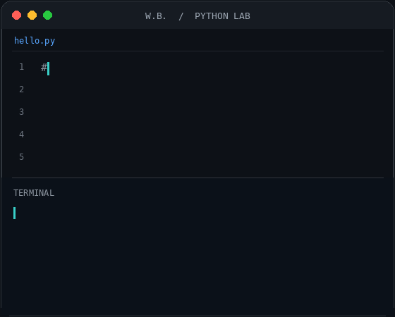

<!-- Salve a arte fornecida em assets/banner-tecnologia.jpg no repositório. -->

  

  

### Tecnologia para empresas. Conhecimento para pessoas.

Com mais de duas décadas de experiência em tecnologia, lidero a **W. B. Soluções em Tecnologia** e atuo diretamente como consultor de infraestrutura e tecnologia. Meu trabalho é entender os desafios de cada empresa e recomendar, planejar e implementar soluções adequadas em redes, sistemas, segurança e bancos de dados. Também compartilho conhecimento como **instrutor de tecnologia na Usina da Paz, em Salinópolis**.

  
  
  
  

  
  

---

### 🧰 Tecnologias e habilidades

<!-- Passe o mouse nos ícones para consultar a descrição. -->
<table border="0" frame="void" rules="none" cellpadding="8" cellspacing="0" style="border-collapse: collapse; border: none;">
  <tr>
    <td border="0" valign="top" width="58%" style="border: none;">
      <h4>Desenvolvimento</h4>
      

        
        
        
        
        
        
        
        
        
      

      <h4>Infraestrutura e plataformas</h4>
      

        
        
        
        
        
      

      <h4>Bancos de dados</h4>
      

        
        
        
      

      <h4>Redes e segurança</h4>
      

        
        
        
        
        
        
      

    </td>
    <td border="0" valign="middle" width="42%" align="center" style="border: none;">
      
    </td>
  </tr>
</table>

---

### 🚀 Iniciativas e soluções

- **[W. B. Soluções em Tecnologia](https://wbservicos.com.br/)** — minha empresa de consultoria e serviços de tecnologia para negócios, com atuação em infraestrutura, nuvem, cibersegurança, suporte e sistemas.
- **[WBLink](https://wblink.com.br/)** — solução de conectividade remota da W. B. Soluções em Tecnologia.
- **[Eduklab](https://eduklab.com.br/)** — iniciativa independente para ampliar o acesso à tecnologia e ao aprendizado, com ferramentas gratuitas, sem cadastro e sem anúncios. Conheça o [Teclaria](https://teclaria.eduklab.com.br/), o [Rabisca](https://rabisca.eduklab.com.br/) e o [Xadrez Battle War](https://xbatllewar.eduklab.com.br/).

---

### 📊 Estatísticas do GitHub

  
  

### 🐍 Atividade de contribuições

<picture>
  <source media="(prefers-color-scheme: dark)" srcset="https://raw.githubusercontent.com/romeuwb/romeuwb/output/github-contribution-grid-snake-dark.svg" />
  <source media="(prefers-color-scheme: light)" srcset="https://raw.githubusercontent.com/romeuwb/romeuwb/output/github-contribution-grid-snake.svg" />
  
</picture>

`Tecnologia aplicada a desafios reais. Conhecimento compartilhado para abrir novos caminhos.`

